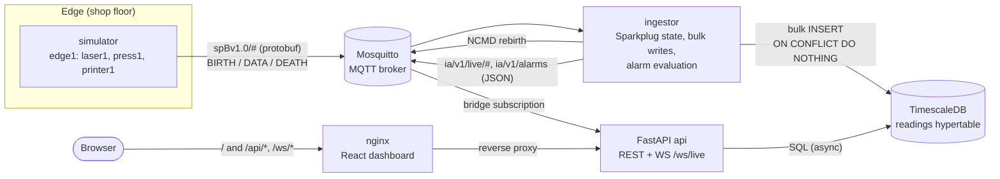

# Industrial Analytics

A shop-floor telemetry platform. Simulated machines (a laser cutter, a stamping press, a 3D printer)
publish **Sparkplug B** over **MQTT**. An **ingestor** stores readings in **TimescaleDB** and
evaluates alarm rules. A **FastAPI** service serves REST plus a **WebSocket** live feed, and a
**React + TypeScript** dashboard shows assets, live charts, history and alarms.

Everything runs with one command (`make up`) and is tested end to end in CI.

## Architecture



The ingestor and the API never call each other. They share only the database and the broker, so
each can be deployed, restarted and scaled on its own ([ADR 0004](docs/adr/0004-separate-ingestor.md)).

### The life of one reading

1. **Edge.** The simulator's edge node sends `NBIRTH` and one `DBIRTH` per machine, declaring every
   metric's name, type, unit and a numeric **alias**. After that it sends `DDATA` with values by
   alias once a second. Its MQTT **Last Will** is an `NDEATH`, so the broker announces it if it
   drops off.
2. **Ingest.** The ingestor subscribes to `spBv1.0/#`. On `DBIRTH` it upserts the asset and its tags
   (auto-registration, no config). On `DDATA` it resolves aliases to tag ids and checks the `seq`
   counter. If it sees a gap, or data from a device it has no birth for, it asks the edge node to
   **rebirth** (`NCMD`).
3. **Store.** Rows go into a bounded buffer that's flushed in bulk every second with
   `ON CONFLICT DO NOTHING` on `(tag_id, ts)`, so a replay can't create duplicates. Alarm rules are
   evaluated in the same transaction, edge-triggered: one event when the limit is crossed and one
   when it clears.
4. **Fan out.** The ingestor republishes each reading and alarm change as small JSON messages. The
   API's MQTT bridge hands them to a broadcaster that gives every WebSocket client its own bounded
   queue, so a slow browser can only lose its own data.
5. **Show.** The dashboard opens one WebSocket. On every (re)connect it **backfills** the last five
   minutes over REST and merges the result by timestamp. The live feed is best-effort; the database
   is the source of truth. History views use `time_bucket` aggregates with a min–max band.

## Quickstart

Needs Docker (with Compose v2), `make` and `openssl`.

```bash
make up      # build and start everything
```

- Dashboard: http://localhost:8080
- API docs (Swagger): http://localhost:8000/docs

The first `make up` writes a random `JWT_SECRET` to `deploy/.env` (gitignored) and reuses it after that.

A fresh database has no users. Sign up (new accounts are viewers), then promote yourself to engineer
so you can acknowledge alarms:

```bash
curl -X POST localhost:8080/api/auth/signup -H 'content-type: application/json' \
  -d '{"email":"you@example.com","password":"choose-a-password"}'
docker compose -f deploy/docker-compose.yml exec db \
  psql -U industrial -d industrial -c "update users set role='engineer' where email='you@example.com'"
```

Alarm rules have no API yet, so add one with SQL. This one fires when laser1's power goes above 1500 W:

```bash
docker compose -f deploy/docker-compose.yml exec db psql -U industrial -d industrial -c \
  "insert into alarm_rules (tag_id, operator, threshold, severity, enabled)
   select t.id, 'gt', 1500, 'critical', true from tags t join assets a on a.id = t.asset_id
   where a.name = 'laser1' and t.name = 'power_w'"
```

### Commands

| Command | What it does |
|---|---|
| `make up` | Build and start the whole stack |
| `make down` | Stop everything, keep the data |
| `make ps` | Status and health of each service |
| `make logs` | Follow logs (`make logs s=ingestor` for one service) |
| `make infra` | Start only Postgres + Mosquitto, to run the apps from source |

## Repository layout

| Path | What's there |
|---|---|
| `apps/api` | FastAPI, SQLAlchemy 2.0 async, Alembic migrations, JWT auth with roles (viewer / engineer / admin), REST + WebSocket, pytest |
| `apps/ingestor` | MQTT → Sparkplug state machine → bulk writes + alarm evaluation |
| `apps/simulator` | Sparkplug B edge node with three simulated machines |
| `packages/sparkplug` | Shared Sparkplug B library (topics, protobuf encode/decode) |
| `apps/web` | React 19 + TypeScript + Vite dashboard, Vitest + Testing Library |
| `deploy` | Compose file, nginx config, Mosquitto config |
| `docs/adr` | Architecture decision records: context, decision, alternatives, consequences |
| `docs/talking-points.md` | Interview notes: pitch, demo script, trade-offs, failure modes |
| `.github/workflows` | Per-app CI (lint, types, tests) plus a full-stack smoke test |

## Quality gates

Every PR runs, filtered by path:

- **API:** ruff, strict mypy, an Alembic upgrade → downgrade → upgrade round trip, and pytest against
  a real TimescaleDB service container.
- **Ingestor, simulator, Sparkplug library:** ruff, mypy, pytest. The ingestor runs against Postgres.
- **Web:** ESLint, `tsc`, Vitest, production build.
- **Stack:** builds every image, runs `docker compose up`, and checks through nginx that the app
  loads, sign-up and login work, assets were auto-registered from DBIRTH, and readings are in the
  database.

## Design decisions

| ADR | Decision |
|---|---|
| [0001](docs/adr/0001-monorepo.md) | Monorepo for all services |
| [0002](docs/adr/0002-timescaledb.md) | Postgres + TimescaleDB for time series and relational data together |
| [0003](docs/adr/0003-sparkplug-b.md) | Sparkplug B over MQTT for machine data |
| [0004](docs/adr/0004-separate-ingestor.md) | A separate ingestor service, not ingestion inside the API |
| [0005](docs/adr/0005-websocket-live-feed.md) | WebSocket live feed with per-client bounded queues |
| [0006](docs/adr/0006-web-dashboard.md) | React dashboard: same-origin proxy, in-memory token, REST as source of truth |
| [0007](docs/adr/0007-containers-and-compose.md) | Multi-stage images, health-gated compose, migrations as a one-shot job |

## Not built yet (on purpose)

Alarm-rule CRUD UI, an admin endpoint for user roles, structured logging and metrics, Kubernetes
manifests, publishing images to a registry, and locked Python dependencies. Each is a known next
step, recorded in the ADRs.
